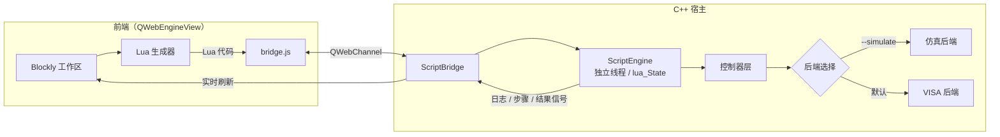

# Blockly 自动化测试平台（原型）

基于 **Qt 6 + Blockly + Lua** 的射频仪器自动化测试平台原型。用户通过拖拽积木搭建测试流程，前端实时生成 Lua 脚本，由 C++ 宿主应用调用真实仪器（VISA）或内置仿真器执行，并将日志、测试结果和步骤高亮实时回传到界面。

> 面向射频功率定标、设备参数读写等场景，验证“图形化编排 → Lua 脚本 → 仪器控制 → 结果反馈”的完整技术链路。


## 功能特性

- **图形化测试编排**：10 个射频测试专用积木，配合逻辑、循环、变量、数学、文本等标准积木，无需手写代码即可搭建测试流程。
- **实时 Lua 代码生成**：积木连接关系直接映射为 Lua 5.4 脚本，生成后的脚本在独立线程中执行，界面不卡顿。
- **执行过程可视化**：执行到测试步骤积木（信号源、频谱仪、设备参数、等待、结果上报）时，编辑器自动高亮该积木并滚动到可见区域；右侧同步输出执行日志与 Pass/Fail 测试结果表格。
- **可靠的执行控制**：支持随时中断；延时函数按 50ms 分片等待，停止操作可及时响应。
- **工作区保存与加载**：测试流程可保存为 JSON，也可加载已有 JSON（例如仓库自带的完整示例）。
- **双后端模式**：默认连接真实仪器（NI-VISA），也可通过参数或配置切换到内置仿真后端。
- **仿真场景与面板**：内置信号源与频谱仪仿真模型，支持正常、信号丢失、频率偏移、功率漂移、偶发超时等场景，便于无硬件条件下验证流程。

## 界面布局

```
┌──────────────────────────────────────────────┬──────────────────┐
│                                              │  执行日志         │
│            Blockly 积木工作区                 ├──────────────────┤
│       （工具箱 / 缩放 / 垃圾桶 / 网格）        │  测试结果表格     │
│                                              │  （Pass / Fail）  │
└──────────────────────────────────────────────┴──────────────────┘
                                      仿真模式下右侧另有“仿真控制面板”
```

## 系统架构



执行流程：

1. 用户拖拽积木，Blockly 生成 Lua 代码字符串。
2. `bridge.js` 通过 `QWebChannel` 调用 C++ 的 `scriptBridge.submitScript()`。
3. `ScriptEngine` 在专用线程中执行脚本，Lua 调用 C++ 注册的业务函数。
4. 控制器层驱动仪器后端（VISA 或仿真），结果通过信号回传前端。
5. 前端刷新日志、结果表格，并高亮当前执行的积木。

## 目录结构

```
.
├── blockly/                      # Blockly 前端资源（通过 qrc 本地打包）
│   ├── index.html                # 编辑器页面
│   ├── custom-blocks.js          # 10 个测试专用积木定义
│   ├── custom-generators.js      # 积木到 Lua 的生成器
│   ├── toolbox.js                # 工具箱分类与默认积木
│   ├── blockly-config.js         # 工作区初始化、运行/停止/保存/加载
│   ├── bridge.js                 # QWebChannel 通信封装
│   ├── msg.zh-hans.js            # Blockly 简体中文文案
│   └── *_compressed.js           # Blockly 核心、标准积木、Lua 生成器
├── controllers/                  # 后端抽象、控制器、VISA 与仿真实现
├── ui/                           # 仿真控制面板
├── config/instruments.json       # 仪器地址、设备地址、信号路径配置
├── examples/blockly-all-blocks.json  # 覆盖全部积木类型的学习示例
├── docs/                         # 阶段设计方案文档
├── lua/                          # Lua 5.4.6 源码
├── MainWindow.*                  # 主窗口与后端装配
├── ScriptEngine.*                # Lua 执行引擎与业务函数注册
├── ScriptBridge.*                # 前后端桥接对象
├── ConfigurationManager.*        # 配置读取
├── resources.qrc                 # 前端与配置资源打包
└── CMakeLists.txt
```

## 技术栈

| 层次 | 技术 |
|------|------|
| 宿主框架 | Qt 6.5.3（Widgets、WebEngineWidgets、WebChannel、Concurrent） |
| 前端编辑器 | Blockly 10.4.3（Zelos 渲染器，简体中文文案） |
| 脚本引擎 | Lua 5.4.6（源码内置编译） |
| 仪器通信 | NI-VISA（可选；未启用时需以仿真模式运行） |
| 构建工具 | CMake 3.16+，C++17 |

## 环境要求

- Windows 10/11
- Qt **6.5.3 msvc2019_64**（需要包含 WebEngine 模块；mingw 套件不包含 WebEngine，无法使用）
- Visual Studio 2019/2022 的 MSVC 工具链
- CMake 3.16 及以上
- 可选：NI-VISA 运行时与头文件（用于连接真实仪器）

## 构建

仓库中已内置 Lua 源码与 Blockly 资源，无需额外下载。

```powershell
cmake -S . -B build -DCMAKE_PREFIX_PATH="C:/Qt/6.5.3/msvc2019_64"
cmake --build build --config Debug
```

也可以直接用 Qt Creator 打开 `CMakeLists.txt`，选择 **Desktop Qt 6.5.3 MSVC2019 64bit** 套件后构建。

CMake 会自动探测 `visa.h` 与 `visa32` 库：

- 找到：定义 `HAVE_VISA`，启用真实仪器后端。
- 未找到：仅编译仿真后端，此时需以仿真模式（`--simulate` 或 `backend=simulator`）运行。

## 运行

```powershell
# 仿真模式（推荐首次运行）
<构建输出目录>\BlocklyPrototype.exe --simulate

# 真实仪器模式（读取 config/instruments.json）
<构建输出目录>\BlocklyPrototype.exe
```

后端模式的选择优先级：

```
--simulate 参数  >  环境变量 BLOCKLY_SIM=1  >  配置项 backend  >  默认 visa
```

## 配置

仪器与信号路径参数位于 [`config/instruments.json`](config/instruments.json)，构建时打包进资源文件：

```json
{
    "backend": "simulator",
    "signalGenerator": { "resourceName": "TCPIP0::192.168.1.100::INSTR" },
    "spectrumAnalyzer": { "resourceName": "TCPIP0::192.168.1.101::INSTR" },
    "device": { "ip": "192.168.1.10", "port": 7 },
    "signalPath": {
        "defaultLineLoss": 2.5,
        "noiseFloorDbm": -100.0,
        "noiseStdDevDb": 0.15
    }
}
```

| 字段 | 说明 |
|------|------|
| `backend` | `simulator` 或 `visa` |
| `signalGenerator.resourceName` | 信号源 VISA 资源名 |
| `spectrumAnalyzer.resourceName` | 频谱仪 VISA 资源名 |
| `device.ip` / `device.port` | 设备控制端口 |
| `signalPath.defaultLineLoss` | 默认线损（dB） |
| `signalPath.noiseFloorDbm` | 仿真底噪（dBm） |
| `signalPath.noiseStdDevDb` | 仿真噪声标准差（dB） |

> 注意：信号源写入功率时已扣除线损，频谱仪读取功率时不再重复扣减，避免结果偏差。

## 使用说明

1. **搭建流程**：从左侧工具箱拖拽积木到工作区，按执行顺序连接。
2. **运行**：点击“运行”，下方日志与结果表格实时刷新，执行到测试步骤积木时自动高亮。
3. **停止**：点击“停止”可中断当前脚本，最迟在下一次业务调用或 50ms 分片等待时生效。
4. **保存 / 加载**：点击“保存工作区”导出 JSON；点击“加载工作区”选择 JSON 导入。
5. **多段流程的执行顺序**：互不连接的顶层积木按工作区 **Y 坐标从上到下**依次生成代码，运行时也按此顺序执行。拖动积木堆会改变顺序。

### 示例工作区

[`examples/blockly-all-blocks.json`](examples/blockly-all-blocks.json) 覆盖工具箱全部积木类型，共 4 组示例：

| 示例 | 内容 |
|------|------|
| 示例1 | 信号源 CW 设置、射频开关、频谱仪设置与读数、等待、结果上报 |
| 示例2 | 设备参数读写、变量、文本拼接、`for` 循环、计数循环 |
| 示例3 | `if / else if / else`、比较、与运算、取反、布尔值（需先执行示例1） |
| 示例4 | 数学运算、取整、绝对值、`math_change`、`while` 循环 |

加载该文件后点击“运行”，即可按示例 1 → 4 的顺序观察完整执行过程。

## 积木与 Lua 接口

| 积木 | 生成的 Lua 调用 | 说明 |
|------|----------------|------|
| 设置信号源 CW | `setSgCW(freq, loss, power)` | 频率 MHz，线损 dB，目标功率 dBm |
| 打开信号源输出 | `setSgRfOn()` | RF 输出开 |
| 关闭信号源输出 | `setSgRfOff()` | RF 输出关 |
| 设置频谱仪 CW | `setSaCW(freq, span, ref)` | span ≤ 0 时默认 10 MHz |
| 读取频谱仪功率 | `getSaPower()` | 返回 dBm |
| 设置设备参数 | `setOmtParam("0C11", value)` | OID 由下拉框选择 |
| 读取设备参数 | `getOmtParam("0C11")` | 返回数值 |
| 上报测试结果 | `sendTestResult(link, item, cond, target, value, unit, status)` | 写入结果表格 |
| 等待 N 毫秒 | `sleep(ms)` | 分片等待，可中断 |
| 输出日志 | `showMsg(msg)` | 输出到日志面板 |

上述业务函数均注册在 [`ScriptEngine.cpp`](ScriptEngine.cpp) 的 `registerFunctions()` 中；语句积木会自动插入 `reportStep(blockId)`，用于执行时的积木高亮。

### 生成代码示例

```lua
reportStep("s1_sg_cw")
setSgCW(1745, 2.5, -30)
reportStep("s1_rf_on")
setSgRfOn()
reportStep("s1_wait")
sleep(500)
reportStep("s1_sa_cw")
setSaCW(1745, 0, 20)
reportStep("s1_result")
sendTestResult("功率定标", "输出功率", '1745MHz -30dBm', '-30±0.5',
               tostring(getSaPower()), "dBm", "Pass")
reportStep("s1_rf_off")
setSgRfOff()
```

## 仿真模式

编译时未找到 VISA，或运行时指定 `--simulate` / `BLOCKLY_SIM=1` / `backend=simulator`，程序会启用仿真后端：

- **信号源仿真**：保存频率、功率、RF 开关状态。
- **频谱仪仿真**：根据信号源状态、底噪与噪声模型计算读数。
- **设备仿真**：提供 OID 参数表（频段、中心频点、带宽、增益微调等）。
- **场景预设**：正常、信号丢失、频率偏移、功率漂移、偶发超时。
- **仿真控制面板**：实时显示仪器状态、切换场景、查看仿真日志。

真实模式下，设备 OID 后端目前仍使用仿真参数表作为兜底；信号源与频谱仪通过 VISA 访问。

## 文档

- [第一阶段：原型验证详细设计方案](docs/BlocklyTestMVP.md)
- [第二阶段：典型积木 + 双后端 + 完整测试运行](docs/MyTestBlocklySecN.md)

## 已知限制

- 设备 OID 参数的真实通信后端尚未实现，真实模式下使用仿真 OID 表。
- 编辑器为原型形态，界面布局与交互仍在迭代。
- 真实仪器行为依赖具体型号的 SCPI 指令兼容性，上线前需逐台验证。

## 致谢

- [Blockly](https://developers.google.com/blockly) — 可视化积木编辑器
- [Qt](https://www.qt.io/) — 跨平台应用框架与 WebEngine
- [Lua](https://www.lua.org/) — 轻量级脚本引擎
